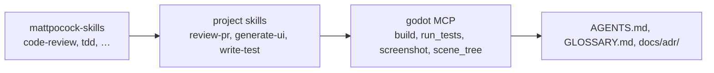

# Starter Kit City Builder

## Agent workflow for game development

This fork adds skills, MCP tools and evals so that coding agents can build UI from a mockup, write tests and review PRs in a Godot project.

Skills live in [`.claude/skills/`](.claude/skills), the MCP server in [`tools/mcp/godot_mcp.py`](tools/mcp/godot_mcp.py). No ADRs have been written yet.

### review-pr evals, graded by the PR author

| Run | PR | Findings | Correct | False | Wrong fixes | Verified before reporting |
|---|---|---|---|---|---|---|
| [001](evals/review-pr/001-pr1.md) | #1 | 9 | 7 | 1 | 1 | 1/9 |
| [002](evals/review-pr/002-pr1.md) ⚠ | #1 | 7 | 6 | 0 | 0 | 7/7 |
| [003](evals/review-pr/003-pr1.md) | #1 | 5 | 4 | 1 | 0 | 4/5 |
| [004](evals/review-pr/004-pr4.md) | #4 | 9 | 8 | 1 | 0 | 8/9 |

⚠ 002 reviewed only 6 new commits, not the full PR, so it isn't directly comparable with the other runs.

Since 001, findings checked before reporting went from 1/9 to 8/9 and wrong fixes from 1 to 0. 001, 003 and 004 each had one false finding, and each one became a rule in the skill.

### generate-ui 001: main menu from a figcraft mockup

| Mockup ([`design/main_menu.png`](design/main_menu.png)) | Result, iteration 1 (`godot.screenshot`) |
|---|---|
|  |  |

28/31 layers fall within ±2px, and 32/33 theme values match exactly. It took 1 of 3 fix iterations. Details: [`evals/generate-ui/001-main-menu.md`](evals/generate-ui/001-main-menu.md).

### Links and setup

- PRs: [#1 Agent skills](https://github.com/pyrozhok/Starter-Kit-City-Builder/pull/1) and [#4 generate-ui + main menu](https://github.com/pyrozhok/Starter-Kit-City-Builder/pull/4).
- Open issues:
  - [#2 pytest suite for the MCP server](https://github.com/pyrozhok/Starter-Kit-City-Builder/issues/2)
  - [#3 rotating tips and relative notification times](https://github.com/pyrozhok/Starter-Kit-City-Builder/issues/3)
  - [#5 Options and Credits screens](https://github.com/pyrozhok/Starter-Kit-City-Builder/issues/5)
  - [#6 save slots and Load screen](https://github.com/pyrozhok/Starter-Kit-City-Builder/issues/6)
  - [#8 Figma input for generate-ui](https://github.com/pyrozhok/Starter-Kit-City-Builder/issues/8)
- Run it in Claude Code:
  1. Install Godot 4.7 and [uv](https://docs.astral.sh/uv/). [`.mcp.json`](.mcp.json) starts the server with `uv run --script tools/mcp/godot_mcp.py`. It runs `godot` by default; to run another binary, set `GODOT_BIN` in your environment before starting Claude Code.
  2. Install the plugin: `/plugin install mattpocock-skills@claude-plugins-official`.
  3. Check that `/mcp` lists `godot` as connected. Then try `/review-pr <n>`, or ask for UI from a mockup (generate-ui) or for a test (write-test).
- Evals were run with mattpocock-skills as of 2026-11-21. The plugin auto-updates, so later runs may differ.
- You don't need figcraft to check the evals. The mockups, the layer tree reader ([`tools/design/figcraft.py`](tools/design/figcraft.py), uv only) and every screenshot are in the repo.
- Figma isn't supported yet. Step 1 of generate-ui needs an adapter that writes the same `design/<name>.map.json`, for example through the Figma MCP ([#8](https://github.com/pyrozhok/Starter-Kit-City-Builder/issues/8)).
- Rules for agents: [`AGENTS.md`](AGENTS.md).

---

This package includes a basic template for a 3D city builder in Godot 4.7. Includes features like;

- Building and removing structures
- Smooth camera controls
- Dynamic MeshLibrary creation
- Saving/loading
- Sprites and 3D Models _(CC0 licensed)_

### Screenshot

### Controls

| Key | Command |
| --- | --- |
| <kbd>W</kbd> <kbd>A</kbd> <kbd>S</kbd> <kbd>D</kbd> | Move camera |
| <kbd>F</kbd> | Camera to center |
| <kbd>Middle mouse button</kbd> | Hold to rotate camera |
| <kbd>Scroll wheel</kbd> | Zoom |
| <kbd>Left mouse button</kbd> | Place building |
| <kbd>DEL</kbd> | Remove building |
| <kbd>Right mouse button</kbd> | Rotate building |
| <kbd>Q</kbd> <kbd>E</kbd>  | Toggle between buildings |
| <kbd>F1</kbd> | Save |
| <kbd>F2</kbd> | Load |

### Instructions

#### 1. How to add more buildings?

Duplicate one of the existing resources in the 'structures' folder, adjust the properties in the inspector. Select the 'Builder' node in the scene and add your new resources to the 'Structures' array.

#### 2. How to adjust building models?

Select the resource of the building you'd like to change in the 'structures' folder, adjust the model in the inspector.

#### 3. How to save and load cities?

Pressing F1 during gameplay will save the current city to disk, F2 will load it from the same location. The file is saved as 'map.res' in the user folder (see below). You can adjust this in the 'action_save' and 'action_load' functions found in the 'builder.gd' script.

User data folder:

> Windows: `%APPDATA%/Godot/app_userdata/Starter Kit City Builder/`

> Linux: `~/.local/share/godot/app_userdata/Starter Kit City Builder/`

> MacOS: `~/Library/Application Support/Godot/app_userdata/Starter Kit City Builder/`

#### 4. How to include city data in the project and load this?

You'll find a sample map in the 'sample map' folder, to load this during gameplay press F3. You can find the function that handles this as 'action_load_resources' found in the 'builder.gd' script.

### License

MIT License

Copyright (c) 2026 Kenney

Permission is hereby granted, free of charge, to any person obtaining a copy of this software and associated documentation files (the "Software"), to deal in the Software without restriction, including without limitation the rights to use, copy, modify, merge, publish, distribute, sublicense, and/or sell copies of the Software, and to permit persons to whom the Software is furnished to do so, subject to the following conditions:

The above copyright notice and this permission notice shall be included in all copies or substantial portions of the Software.

THE SOFTWARE IS PROVIDED "AS IS", WITHOUT WARRANTY OF ANY KIND, EXPRESS OR IMPLIED, INCLUDING BUT NOT LIMITED TO THE WARRANTIES OF MERCHANTABILITY, FITNESS FOR A PARTICULAR PURPOSE AND NONINFRINGEMENT. IN NO EVENT SHALL THE AUTHORS OR COPYRIGHT HOLDERS BE LIABLE FOR ANY CLAIM, DAMAGES OR OTHER LIABILITY, WHETHER IN AN ACTION OF CONTRACT, TORT OR OTHERWISE, ARISING FROM, OUT OF OR IN CONNECTION WITH THE SOFTWARE OR THE USE OR OTHER DEALINGS IN THE SOFTWARE.

Assets included in this package (2D sprites, 3D models and sound effects) are [CC0 licensed](https://creativecommons.org/publicdomain/zero/1.0/)

### Claude Code tooling

- **MCP server** `godot` (`tools/mcp/godot_mcp.py`, registered in `.mcp.json`, needs [uv](https://docs.astral.sh/uv/)):
  - `build` — reimport assets and compile all project scripts (optionally `export_preset`)
  - `run_tests` — run the GUT suite in `tests/` (filter by `script` or `test_name`)
  - `find_scenes` / `scene_tree` — search scenes by node name, type or script; dump a scene's node tree
  - `GODOT_BIN` in your environment picks the Godot binary (default `godot`); it must match the project version.
- **Tests**: [GUT](https://github.com/bitwes/Gut) 9.7.1 in `addons/gut`; CLI:
  `godot --headless -s res://addons/gut/gut_cmdln.gd -gconfig=res://.gutconfig.json -gexit`
- **Skills** (`.claude/skills/`): `generate-ui`, `write-test`, `review-pr`.
- **Plugin** [mattpocock-skills](https://github.com/mattpocock/skills) is required: `review-pr` runs its
  `code-review`, `write-test` its `tdd`, and `docs/agents/` refer to `/triage`, `/domain-modeling`,
  `/grill-with-docs`. `.claude/settings.json` enables it, so Claude Code offers to install it when you
  trust the folder; or install by hand: `/plugin install mattpocock-skills@claude-plugins-official`.
