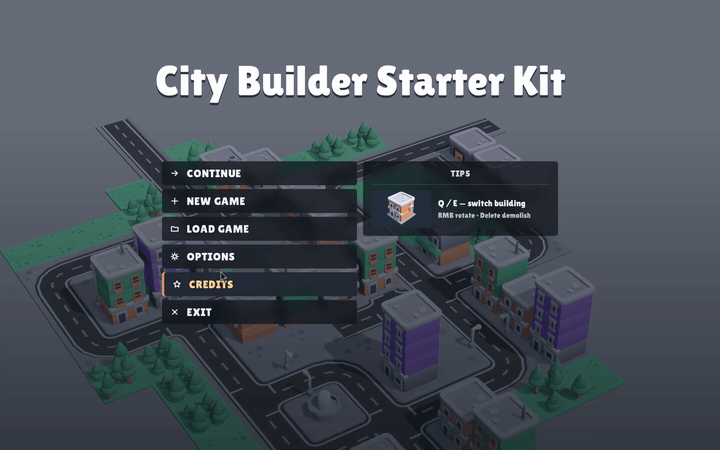
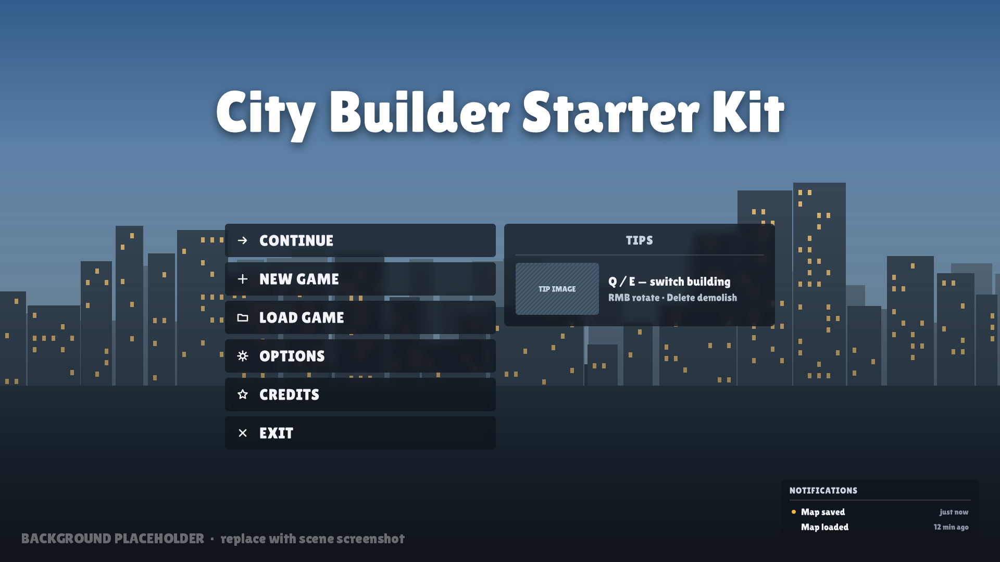
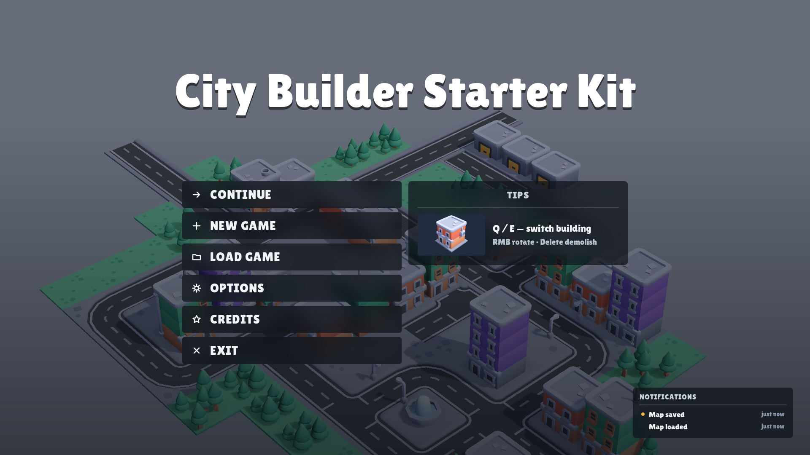
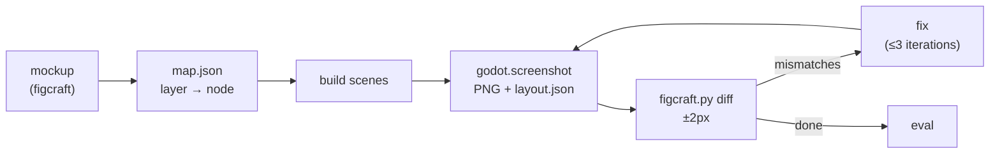
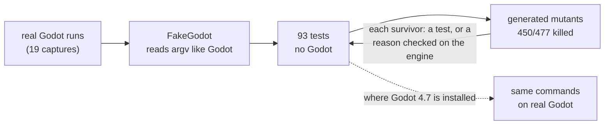
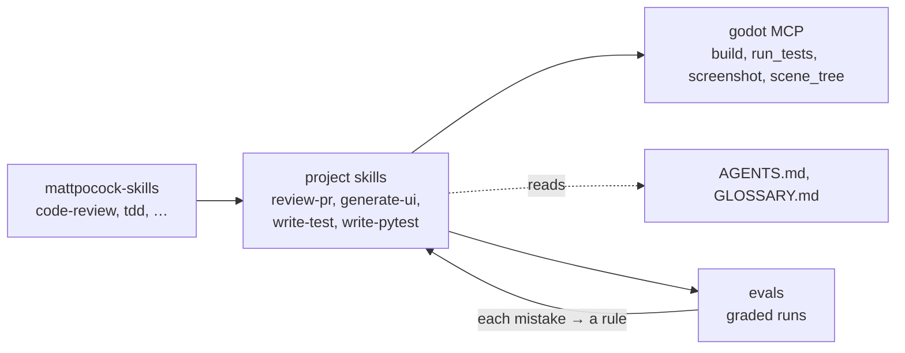

# AI toolkit for game development

A Claude Code toolkit for Godot 4.7 that builds game UI from mockups, reviews pull requests, and writes tests.
The skills share a Godot MCP server, so agents can inspect scenes, render UI and run tests to check their work.

- **Build UI** (`generate-ui`): turn a mockup into a Godot scene, then compare the rendered layout with the design.
- **Review PRs** (`review-pr`): check findings against the code and engine behavior before reporting them.
- **Write tests** (`write-test`, `write-pytest`): write gameplay tests and Python tests for the MCP server.

An eval grades every run, and each mistake it finds becomes a rule in the skill.
The game is a fork of Kenney's Starter Kit City Builder. Built in one day with Claude Code: 105 commits on 2026-11-21.

Main menu built by generate-ui from a figcraft mockup.

## Results

- **generate-ui**: 28/31 layers of the mockup within ±2px, after 1 fix iteration of 3. The run took 16 minutes from the approved plan to the final screenshot. When the mockup contradicted itself, the agent asked instead of guessing.
- **review-pr**: in 4 runs on 2 PRs, findings checked against the code before reporting went from 1/9 to 8/9, and wrong fixes from 1 to 0. False findings didn't go down: 3 of the 4 runs had one.
- **write-pytest**: 93 tests for the `godot` MCP server that run without Godot and kill 450 of 477 generated mutants. Writing them found 6 bugs in the server, each fixed together with a test that failed before the fix.

| Mockup ([`design/main_menu.png`](design/main_menu.png)) | Result, iteration 1 (`godot.screenshot`) |
|---|---|
|  |  |

## Requirements

- Godot 4.7 and [uv](https://docs.astral.sh/uv/).
- Claude Code. The evals ran on Opus 5.5.
- The plugin [mattpocock-skills](https://github.com/mattpocock/skills). The evals ran with version 1.3.1 (`49dd158`). The plugin updates itself, so later runs may use a newer version.
  - Install: `/plugin install mattpocock-skills@claude-plugins-official`. `.claude/settings.json` enables it, so Claude Code also offers to install it when you trust the folder.
  - `review-pr` calls its `code-review`; `write-test` and `write-pytest` call its `tdd`. Without the plugin these skills stop and ask you to install it.
  - The project skills add what the plugin can't know about Godot and this game: the build and test gates, a Godot checklist, the screenshot-and-compare loop, and the rules that came out of the evals.

## generate-ui: main menu from a mockup

The mockup was made in figcraft, a Figma-like design tool with an MCP server. `tools/design/figcraft.py` reads its layer tree, so the agent can compare its screenshot with the mockup layer by layer.

- 32/33 theme values match exactly. The 33rd is the shade gradient, which was made darker on purpose so the title and the disabled buttons stay readable over the live city, which is brighter than the mockup's night sky.
- Of the 3 layers off by more than 2px, the eval lists all 3 as expected. One is 3px taller because Godot's line height is ascent + descent, and the skill now lists that mismatch as expected. The other two are a notification's text and time: the build shows "just now" where the mockup has "12 min ago", because relative times were cut from the run ([#3](https://github.com/pyrozhok/Starter-Kit-City-Builder/issues/3)).
- **The agent asked instead of guessing.** In the mockup's "no save" frame the disabled button icons had opacity 1.0, but the component's `State=Disabled` variant says 0.35. The agent built 0.35 and asked me which one was right. The answer was the component.
- You can check the geometry without figcraft or Godot. The repo has the mockups, every screenshot and the iteration-1 `.layout.json` files. With uv alone, `uv run --script tools/design/figcraft.py diff design/main_menu.figcraft MainMenu evals/generate-ui/001/iter1_main_save.layout.json design/main_menu.map.json` gives 28/31.
- Figma isn't supported yet. Step 1 of generate-ui needs an adapter that writes the same `design/<name>.map.json`, for example through the Figma MCP ([#8](https://github.com/pyrozhok/Starter-Kit-City-Builder/issues/8)).

Details: [`evals/generate-ui/001-main-menu.md`](evals/generate-ui/001-main-menu.md).

### Limits

- One run on one screen.
- An agent made the mockup too, in another session: I gave it a reference screenshot, and it drew the layers through the FigCraft MCP. Its layers are probably cleaner and better named than in a designer's file. A designer's Figma file would be the real test ([#8](https://github.com/pyrozhok/Starter-Kit-City-Builder/issues/8)).
- I wrote the skill and graded the run.

## review-pr: 4 graded runs

| Run | PR | Findings | Correct | False | Wrong fixes | Verified before reporting |
|---|---|---|---|---|---|---|
| [001](evals/review-pr/001-pr1.md) | #1 | 9 | 7 | 1 | 1 | 1/9 |
| [002](evals/review-pr/002-pr1.md) ⚠ | #1 | 7 | 6 | 0 | 0 | 7/7 |
| [003](evals/review-pr/003-pr1.md) | #1 | 5 | 4 | 1 | 0 | 4/5 |
| [004](evals/review-pr/004-pr4.md) | #4 | 9 | 8 | 1 | 0 | 8/9 |

Findings: reported by the agent; Correct / False: as graded; Wrong fixes: correct findings with a wrong proposed fix; Verified: findings the agent checked against the code before reporting.

⚠ 002 reviewed only 6 new commits, not the full PR, so it isn't directly comparable with the other runs.

001, 003 and 004 each had one false finding, and each one became a rule in the skill (`f32e83f`, `7e4f65b`, `5297b37`).

### From a false finding to a rule

In run 004, finding #6 said a cleanup line would leak if the assert before it failed, and proposed moving it to `after_each`. That's false: a failed GUT assert doesn't stop the test. The agent had read the test code but never checked how GUT behaves. Commit `5297b37` added this to step 5 of [`review-pr`](.claude/skills/review-pr/SKILL.md):

> GUT asserts don't abort the test: the lines after a failed assert still run. Don't suggest moving cleanup out of a test body on that ground.

### Limits

- Runs 001–003 all reviewed PR #1, and the rules added after them came from that PR. Only 004 tests the skill on a PR it wasn't tuned on.
- Precision is graded, recall isn't: nobody counted the bugs the agent missed.
- I graded every run, and I'm also the author of the skill and of both PRs.
- Next: a set of PRs with planted bugs, rerun after every rule change, to measure both.

## write-pytest: tests for the MCP server

The skills reach Godot only through the `godot` MCP server, so a bug there misleads every agent. [`write-pytest`](.claude/skills/write-pytest/SKILL.md) writes pytest tests for `tools/`. Its first run wrote the suite for the server ([#2](https://github.com/pyrozhok/Starter-Kit-City-Builder/issues/2)).

- Godot is tested as a separate process. A fake executable finds the project through `--path`, writes JUnit or the screenshot where the arguments point, and replays a captured run of Godot 4.7.2. A wrong command line loses its results here, as it would with Godot. Where Godot 4.7 is installed, the same commands also run on the real engine.
- Bugs the tests found: `screenshot` returned `ok: true` for a scene with a broken shader or a `push_error`, a path outside the project reached the agent as a bare "Error executing tool", and one byte of Godot's output that isn't UTF-8 broke every tool.
- CI runs the suite on every PR that touches `tools/`, in about 20 seconds, without Godot.

Details: [`evals/write-pytest/001-issue2.md`](evals/write-pytest/001-issue2.md).

### Limits

- One run on one module. `tools/design/figcraft.py` has no suite yet.
- The agent's first report was wrong. It claimed 26 of 26 mutations caught, but it had picked those 26 itself, after writing the tests. Generated mutants gave 299 of 453, and the suite was reworked to 450 of 477.
- The eval was graded by a separate Claude session, not by a person. That grading found 6 surviving mutants the eval had wrongly called equivalent, and led to 3 of the 6 bugs.

## How it's built

Skills live in [`.claude/skills/`](.claude/skills), the MCP server in [`tools/mcp/godot_mcp.py`](tools/mcp/godot_mcp.py) with its tests in [`tools/mcp/tests/`](tools/mcp/tests), and the evals in [`evals/`](evals). write-test's evals are in [`evals/write-test/`](evals/write-test).

### What carries over to another engine

The skills run the engine only through the MCP tools: `build`, `run_tests`, `screenshot` (a PNG plus a `.layout.json` with every visible Control's rect), and `scene_tree` / `find_scenes`. The layout diff compares mockup rects with `.layout.json` and knows nothing about Godot. To port the workflow, reimplement those tools for the new engine (`godot_mcp.py` is 356 lines; its tests show what each tool must return) and rewrite the Godot-specific rules in the skills (scene text, mouse filters, GUT).

Links and setup

- PRs: [#1 Agent skills](https://github.com/pyrozhok/Starter-Kit-City-Builder/pull/1), [#4 generate-ui + main menu](https://github.com/pyrozhok/Starter-Kit-City-Builder/pull/4) and [#11 write-pytest + MCP server tests](https://github.com/pyrozhok/Starter-Kit-City-Builder/pull/11).
- Roadmap:
  - [#3 rotating tips and relative notification times](https://github.com/pyrozhok/Starter-Kit-City-Builder/issues/3)
  - [#5 Options and Credits screens](https://github.com/pyrozhok/Starter-Kit-City-Builder/issues/5)
  - [#6 save slots and Load screen](https://github.com/pyrozhok/Starter-Kit-City-Builder/issues/6)
  - [#8 Figma input for generate-ui](https://github.com/pyrozhok/Starter-Kit-City-Builder/issues/8)
- Run it in Claude Code:
  1. Install everything under [Requirements](#requirements). [`.mcp.json`](.mcp.json) starts the server with `uv run --script tools/mcp/godot_mcp.py`. It runs `godot` by default; to run another binary, set `GODOT_BIN` in your environment before starting Claude Code. The binary must be Godot 4.7: any other version rewrites `*.import` on every build.
  2. Check that `/mcp` lists `godot` as connected. Then try `/review-pr <n>`, or ask for UI from a mockup (generate-ui), a game test (write-test) or a test for the MCP server (write-pytest).
- MCP tools of the `godot` server ([`tools/mcp/godot_mcp.py`](tools/mcp/godot_mcp.py)):
  - `build`: reimport assets and compile all project scripts (optionally `export_preset`).
  - `run_tests`: run the GUT suite in `tests/` (filter by `script` or `test_name`).
  - `find_scenes` / `scene_tree`: search scenes by node name, type or script; dump a scene's node tree.
  - `screenshot`: render a scene in windowed Godot at an exact size (optional `state`, `hover`) and save a PNG plus a `.layout.json` of every visible Control's rect.
- Tests: [GUT](https://github.com/bitwes/Gut) 9.7.1 in `addons/gut`. From the CLI: `godot --headless -s res://addons/gut/gut_cmdln.gd -gconfig=res://.gutconfig.json -gexit`.
- Tests for the MCP server, no Godot needed: `uv run --with pytest --with 'mcp>=2.3,<3' pytest --import-mode=importlib tools`.
- `docs/agents/` refers to the plugin's `/triage`, `/domain-modeling` and `/grill-with-docs`.
- Rules for agents: [`AGENTS.md`](AGENTS.md).

---

## Original starter kit (Kenney)

This package includes a basic template for a 3D city builder in Godot 4.7. Includes features like;

- Building and removing structures
- Smooth camera controls
- Dynamic MeshLibrary creation
- Saving/loading
- Sprites and 3D Models _(CC0 licensed)_

### Screenshot

### Controls

| Key | Command |
| --- | --- |
| <kbd>W</kbd> <kbd>A</kbd> <kbd>S</kbd> <kbd>D</kbd> | Move camera |
| <kbd>F</kbd> | Camera to center |
| <kbd>Middle mouse button</kbd> | Hold to rotate camera |
| <kbd>Scroll wheel</kbd> | Zoom |
| <kbd>Left mouse button</kbd> | Place building |
| <kbd>DEL</kbd> | Remove building |
| <kbd>Right mouse button</kbd> | Rotate building |
| <kbd>Q</kbd> <kbd>E</kbd>  | Toggle between buildings |
| <kbd>F1</kbd> | Save |
| <kbd>F2</kbd> | Load |

### Instructions

#### 1. How to add more buildings?

Duplicate one of the existing resources in the 'structures' folder, adjust the properties in the inspector. Select the 'Builder' node in the scene and add your new resources to the 'Structures' array.

#### 2. How to adjust building models?

Select the resource of the building you'd like to change in the 'structures' folder, adjust the model in the inspector.

#### 3. How to save and load cities?

Pressing F1 during gameplay will save the current city to disk, F2 will load it from the same location. The file is saved as 'map.res' in the user folder (see below). You can adjust this in the 'action_save' and 'action_load' functions found in the 'builder.gd' script.

User data folder:

> Windows: `%APPDATA%/Godot/app_userdata/Starter Kit City Builder/`

> Linux: `~/.local/share/godot/app_userdata/Starter Kit City Builder/`

> MacOS: `~/Library/Application Support/Godot/app_userdata/Starter Kit City Builder/`

#### 4. How to include city data in the project and load this?

You'll find a sample map in the 'sample map' folder, to load this during gameplay press F3. You can find the function that handles this as 'action_load_resources' found in the 'builder.gd' script.

### License

MIT License

Copyright (c) 2026 Kenney

Permission is hereby granted, free of charge, to any person obtaining a copy of this software and associated documentation files (the "Software"), to deal in the Software without restriction, including without limitation the rights to use, copy, modify, merge, publish, distribute, sublicense, and/or sell copies of the Software, and to permit persons to whom the Software is furnished to do so, subject to the following conditions:

The above copyright notice and this permission notice shall be included in all copies or substantial portions of the Software.

THE SOFTWARE IS PROVIDED "AS IS", WITHOUT WARRANTY OF ANY KIND, EXPRESS OR IMPLIED, INCLUDING BUT NOT LIMITED TO THE WARRANTIES OF MERCHANTABILITY, FITNESS FOR A PARTICULAR PURPOSE AND NONINFRINGEMENT. IN NO EVENT SHALL THE AUTHORS OR COPYRIGHT HOLDERS BE LIABLE FOR ANY CLAIM, DAMAGES OR OTHER LIABILITY, WHETHER IN AN ACTION OF CONTRACT, TORT OR OTHERWISE, ARISING FROM, OUT OF OR IN CONNECTION WITH THE SOFTWARE OR THE USE OR OTHER DEALINGS IN THE SOFTWARE.

Assets included in this package (2D sprites, 3D models and sound effects) are [CC0 licensed](https://creativecommons.org/publicdomain/zero/1.0/)
