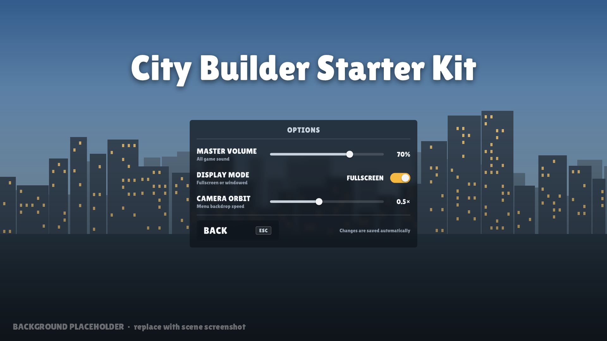
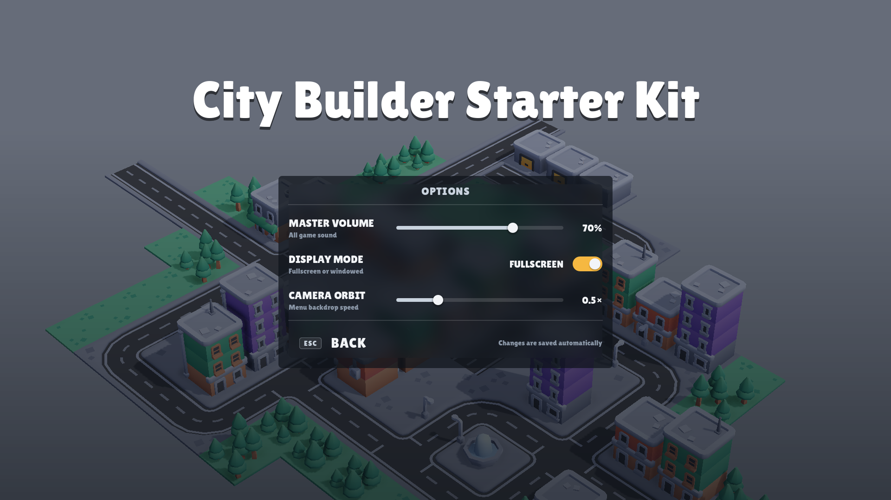
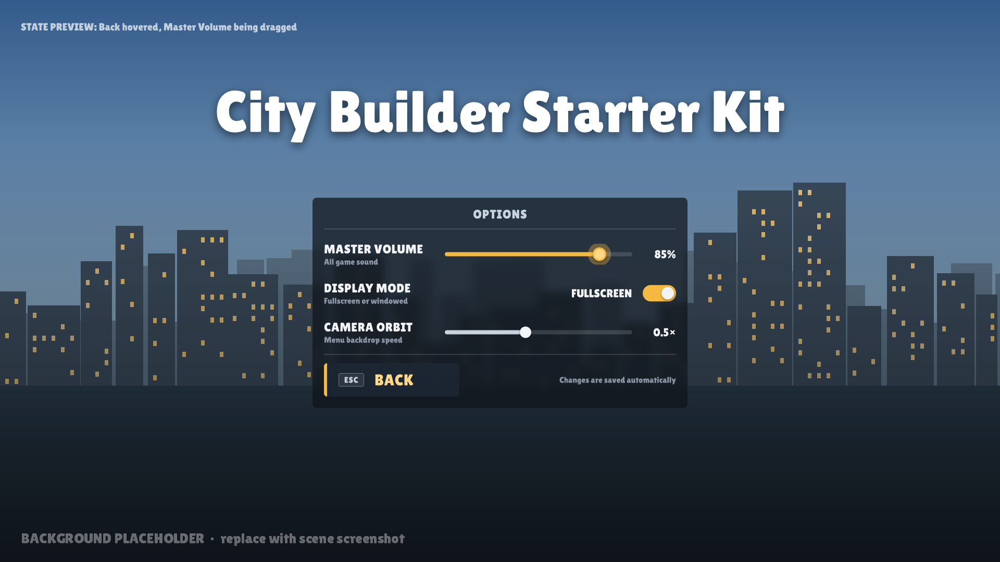
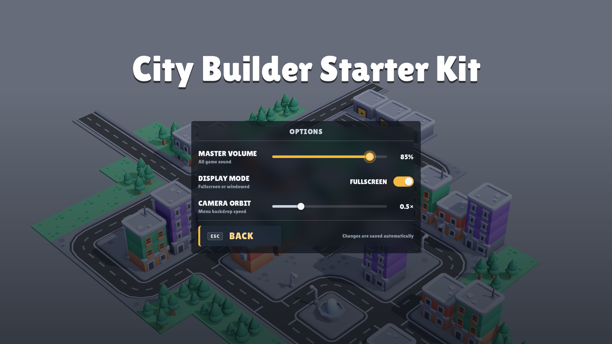

# generate-ui eval 002: Options screen, held out from the skill's tuning

- **Target**: `design/options.figcraft`, frames `Options` (default) and `Options_Hover` (Back hovered,
  volume slider dragged); exports `design/options.png`, `options_hover.png`, `options_components.png`.
- **Why**: 001 ran on the main menu, the screen the skill was written and then fixed against
  (`ad1ab10`, `0b1c590`). Options has control types the main menu doesn't: sliders, a toggle, a keycap.
- **Date**: 2026-11-22
- **Skill version**: `.claude/skills/generate-ui/` unchanged since `0b1c590`.
- **Mockup**: drawn in figcraft by a separate agent session told to read only the main menu mockup
  and #5's Options section (the limit was in the prompt, not enforced). Then changed by the grader
  with the user, before the run: Lilita One loaded for the export (the PNGs had a fallback font);
  Back without the Close icon the agent had picked, with the ESC keycap left of the label (a new
  MenuButton property `ShowKey`) instead of a separate "ESC to go back" hint; that hint replaced by
  "Changes are saved automatically"; the instance's `Label` property set to BACK (it still said
  NEW GAME). Commits `62b9076`, `f083b54`.
- **Agent**: one fresh headless `claude -p` session (Opus 5.5) in a worktree of `feat/measure-skills`,
  resumed with `--resume` for each answer. The prompt adds one line 001 didn't need, being
  interactive: "Wherever the skill says to stop for me, end your turn there".
- **Graded by**: the user, after a manual check of the game: all as described by the agent.

## Run

| Step | Result | Time |
|---|---|---|
| 1. Parse | Layer → node table for both frames, `design/options.map.json`; the annotation and the background placeholder skipped. Stopped with 4 mockup questions and 3 behaviour questions. | 2 min 49 s |
| Stop: shown to the user | Approved with answers: content gap 8 as in the mockup; Pressed state for every MenuButton; defaults kept as today (volume 100%, windowed, orbit 1×), the mockup's values only in the preview states. | |
| 2. Build | Components (`keycap`, `option_slider`, `option_toggle`), Settings in `user://settings.cfg`, `OptionsMenu`, wiring in `main.gd`, MenuButton Pressed. GUT 70/70, 0 orphans; `godot.build` ok. | |
| 3–5. Iterations | 2 of 3: slider 44 → 40 px tall, toggle 40 → 32 px. | |
| 6. Report | Expected mismatches listed; four questions on what a still frame can't show. | 8 min 37 s from the approved plan |

**Iterations used: 2 of 3. Human edits to the code: 0.**

After the run, review of PR #27 led to fix commits on the agent's options/settings code, so the
grade above describes the run, not the merged code: `45a178f` (read whole-number volume and orbit
speed from the file), `6814e63` (keep editing the owner's settings after a preview state), `b34def1`
(save on drag end, toggle and Back, not every slider tick), `affb0ce` (commit wheel and keyboard
slider changes), `6d2758c` (slider labels read the slider values).

## Screenshots

| | Mockup | Result |
|---|---|---|
| Default |  |  |
| Back hovered, volume dragged |  |  |

## Comparison

`figcraft.py diff` reports **3/58**: `map.json` holds both frames' layers, so each frame's diff
counts the other frame's 29 as not found. Per frame (29 layers, both frames the same):

| Check | Within ±2px |
|---|---|
| x and width | 26/29 |
| x, y, width and height | 3/29 |

- **y and height: expected.** Godot's line height (ascent + descent) makes each text line 1–3 px
  taller than the mockup, which the skill lists as expected; here it adds up down the panel, which
  ends 11 px lower (415 px tall, not 404). 001's menu had no stacked text rows, so this didn't show.
  A diff that checks each layer's position relative to its row would separate the two.
- **The 3 x/width misses**: the row titles, 2–8 px narrower, because 2% letter spacing at 24 px
  (0.48 px) rounds to 0.
- **Theme values: 66/68 equal the mockup.** Counted over what the run's commits added to
  `scenes/ui/theme.tres` (`6f2fb1e`, `84c6c92`, `3e689c9`; `d1ef890` doesn't touch it) against
  `figcraft.py tree`: colours, font sizes, radii, border widths, paddings, gaps, track height,
  knob centring, one radius per box. The 2 that differ are letter spacing, which Godot's
  `spacing_glyph` takes in whole pixels: row titles 0 for 2% at 24 px (0.48), keycap 1 for 4% at
  16 px (0.64, the menu buttons' variation reused). Not counted: knob and toggle SVGs (textures),
  the hover+pressed font colour (no such state in the mockup), the keycap border width (the file
  leaves its stroke weight at figcraft's default; the theme has 1).
- **Found in the mockup**: its 85% volume knob sits where 82.5% would be, so the build's 85% knob is
  9 px further right.

## New control types

| Mockup component | Godot | Mapped how |
|---|---|---|
| Slider (Normal, Hover, Pressed) | `HSlider` in `option_slider.tscn` | track = `slider` style, fill = `grabber_area` / `_highlight`, knob = `grabber` SVGs; Pressed through an `OptionSliderPressed` variation |
| Toggle (On/Off × Default, Hover) | `CheckButton` in `option_toggle.tscn` | `checked` / `unchecked` SVG icons; its 10 px hover glow dropped to keep 32 px |
| Keycap | `keycap.tscn` | `PanelContainer` + `Label` |
| MenuButton `ShowKey` | `menu_button.tscn` `key` property | a hidden `Keycap`, label margin 91 px (22 + 49 + 20) |

## Findings

### The first run skipped the stop after parsing

A first attempt (prompt without the "stop for me" line, discarded) parsed the mockup and started
building without the stop `mockup.md` step 1 requires. A headless session runs to the end unless
told it can stop; the skill's "Stop and wait" didn't hold there. The run above, with the line,
stopped where the skill says.

### The skill's rules held on new controls

The agent asked about the instance override of the panel's gap (component 12, instance 8) instead of
applying "the component wins", and kept the mockup's preview values out of the defaults once told.

## Left open

- The line-height offset that adds up down a panel: the diff could compare positions per row.
- Keyboard focus look on the slider and toggle: Godot's default, not in the mockup.
- Credits (#5).
